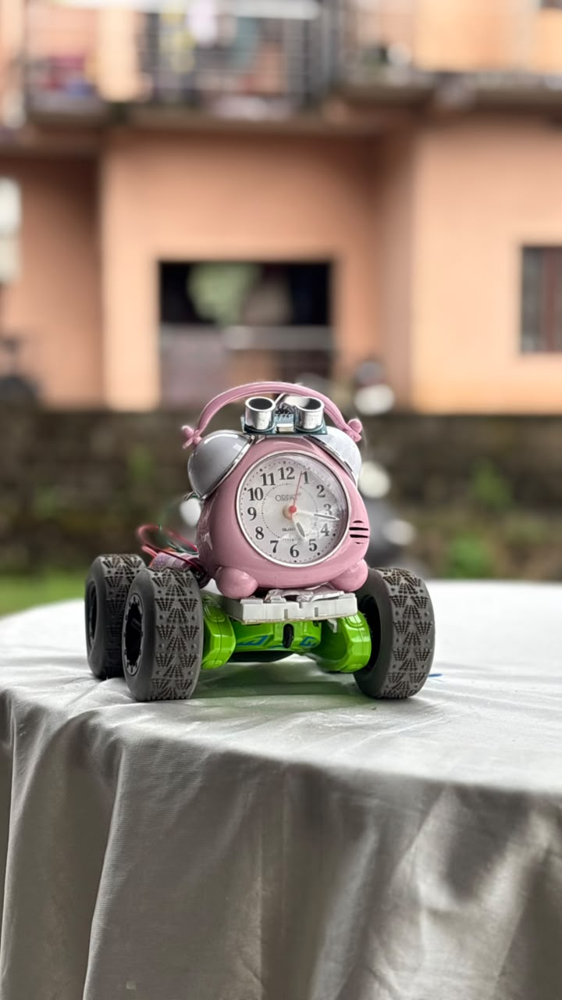
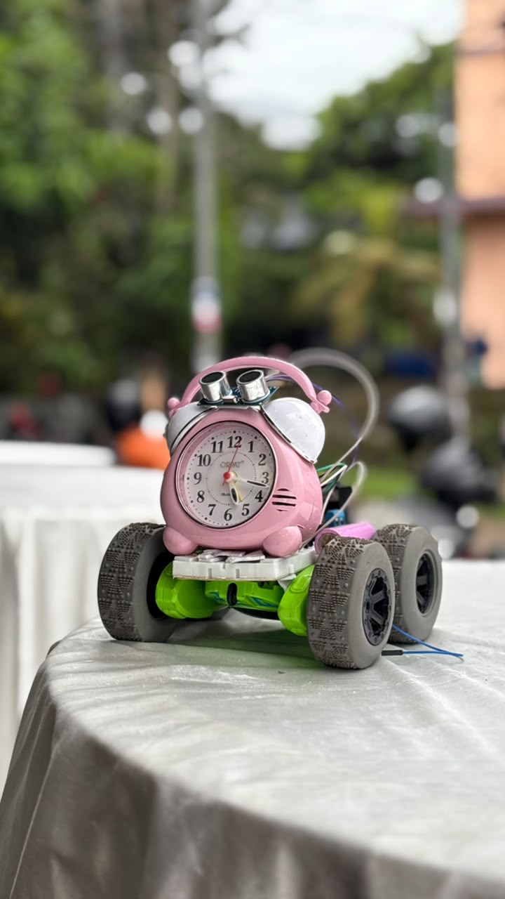
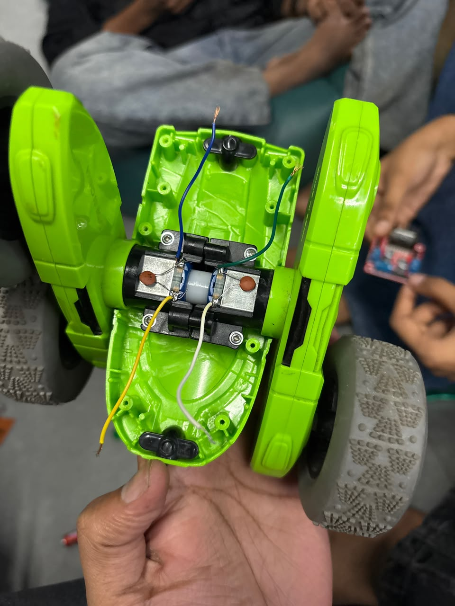
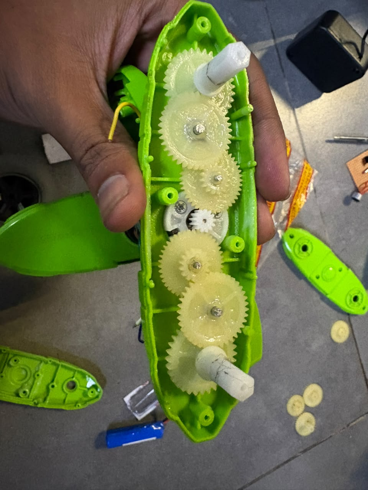
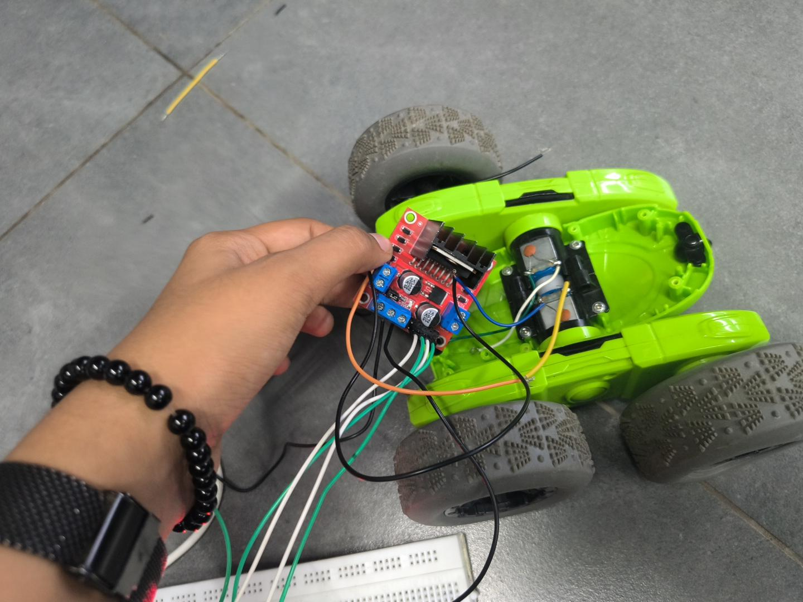
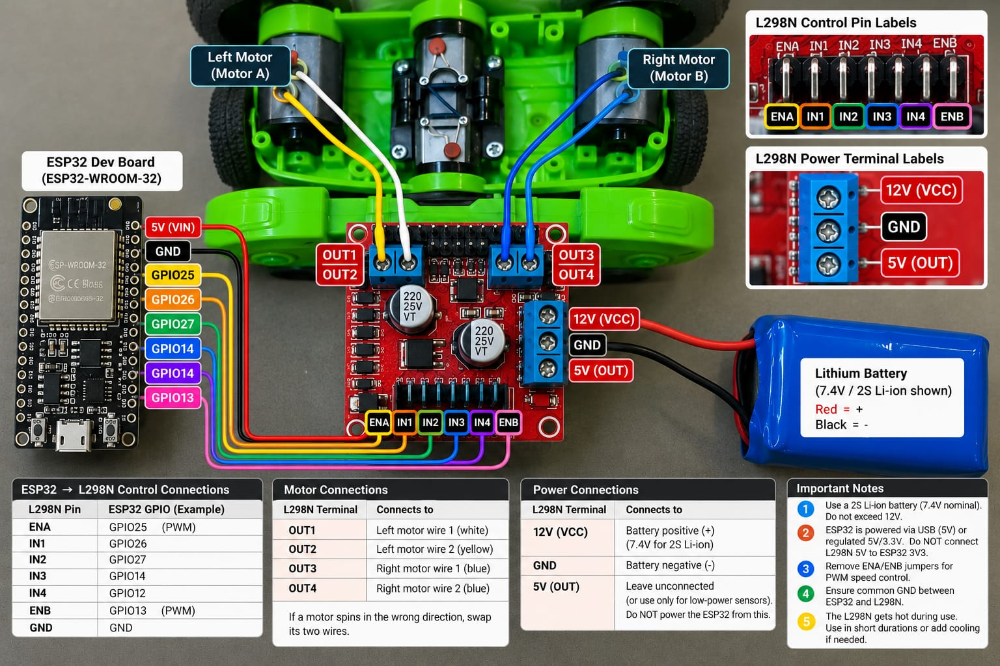

# Shuttumani

### The little alarm clock that learned to run away.

An obstacle-detecting toy built from a repurposed alarm clock, a toy-car chassis, and an ESP32.

[Overview](#how-it-works) · [Build](#hardware) · [Firmware](#upload-the-firmware) · [Wiring](docs/wiring.md) · [Troubleshooting](docs/troubleshooting.md)

 

## Meet Shuttumani

An HC-SR04 ultrasonic sensor checks the space ahead. An ESP32 uses an L298N motor driver to move the toy forward when the path is clear. At **20 cm or closer**, it stops, backs up briefly, then stops again. Readings appear in the Serial Monitor.

> [!NOTE]
> This is an early one-motor prototype. The clock is part of the body; timekeeping, an audible alarm, steering, and turning are not implemented yet.

## A look inside

The build reuses the toy car's motor and gearbox beneath the clock shell.

  
  
   
  Motor and wiring · Gear train

  
   
  Assembly in progress: positioning the motor driver on the chassis

## What it does

- Drives one DC motor with an ESP32 and L298N.
- Detects nearby obstacles with an HC-SR04.
- Moves forward for valid readings beyond 20 cm.
- Reverses briefly when a valid reading is 20 cm or less, then stops.
- Stops safely when a reading is missing or outside the accepted range.
- Prints valid distances to the Serial Monitor.

## Hardware

- ESP32 development board
- L298N motor driver and one DC motor (the prototype uses a salvaged toy-car motor)
- HC-SR04 ultrasonic sensor
- 3.7 V rechargeable Li-ion cell with suitable protection and charging arrangements
- USB cable for programming and powering the ESP32 during development
- Jumper wires
- 1 kΩ and 2 kΩ resistors, or a suitable level shifter, for the sensor ECHO signal

### Pin map

| Module | Pin | Connect to |
|---|---|---|
| L298N | ENA | ESP32 GPIO 25 |
| L298N | IN1 | ESP32 GPIO 26 |
| L298N | IN2 | ESP32 GPIO 27 |
| L298N | OUT1 / OUT2 | DC motor terminals |
| HC-SR04 | TRIG | ESP32 GPIO 32 |
| HC-SR04 | ECHO | ESP32 GPIO 33 **through a voltage divider** |
| HC-SR04 | VCC | USB-powered ESP32 5V/VIN, if available on your board |
| HC-SR04 | GND | Common ground |
| ESP32 | GND | Common ground with sensor and L298N |
| Battery | Positive | L298N motor supply input, if suitable for the motor and module |
| Battery | Negative | Common ground |

**Remove the L298N ENA jumper** when GPIO 25 controls ENA. See the detailed [wiring guide](docs/wiring.md) before connecting power.

### Wiring illustration

> [!WARNING]
> This illustration is a visual reference only and **does not match this project's wiring**. It shows two motors, extra ESP32 GPIO connections, and a 7.4 V two-cell battery. Shuttumani's current firmware uses one motor on GPIO 25/26/27, and the project documents a single 3.7 V cell. Do not copy the diagram's pin or power connections. Use the pin map above and [wiring guide](docs/wiring.md).

  

## Safety first

> [!CAUTION]
> **HC-SR04 ECHO can output about 5 V. ESP32 GPIO pins are not 5 V tolerant.** Use a suitable voltage divider or level shifter between ECHO and GPIO 33. Do not connect ECHO directly to the ESP32.

- Connect ESP32 GND, sensor GND, L298N GND, and battery negative together.
- Disconnect all power before changing wiring.
- A single 3.7 V Li-ion cell may not provide enough voltage for a motor through an L298N. The driver has a significant voltage drop, so the motor may fail to start or run unreliably.
- Never connect the battery directly to the ESP32 3.3 V pin. Do not connect the L298N 5V terminal to ESP32 3.3 V.
- L298N regulator and jumper configurations vary by module. Check the exact module documentation; do not assume its 5V terminal is always an output.
- Avoid connecting USB and an external supply in a way that makes their outputs conflict.
- Use a protected Li-ion cell and an appropriate charger. Never short-circuit or overcharge the cell, or leave it unattended while charging.
- The motor can start unexpectedly. Keep the wheels raised during initial tests and keep hands clear.

## Upload the firmware

1. Install the Arduino IDE and the ESP32 board package published by Espressif Systems.
2. Connect the ESP32 over USB. If it does not appear, install the USB-to-serial driver for your board.
3. Open [`firmware/runaway_alarm_clock/runaway_alarm_clock.ino`](firmware/runaway_alarm_clock/runaway_alarm_clock.ino).
4. In **Tools**, select your ESP32 board and its serial port.
5. Upload the sketch. If necessary, use the board's boot button as described in its documentation.
6. Open **Serial Monitor** at **115200 baud**.
7. With wheels raised, test the sensor and motor while keeping clear of moving parts.

The sketch uses `analogWrite()` from the Arduino ESP32 core and needs no additional library.

## How it works

1. The ESP32 sends a 10 μs trigger pulse to the HC-SR04 and measures the ECHO pulse with `pulseIn()`.
2. It estimates distance using `duration × 0.0343 / 2` (sound travel time in centimeters, divided by two for the round trip).
3. A valid distance is between 2 cm and 100 cm. Readings are printed to Serial.
4. Above 20 cm, the motor moves forward. At or below 20 cm, the motor stops for 200 ms, reverses for 500 ms, then stops for 500 ms.
5. Missing echoes (6,000 μs timeout) and readings outside the accepted range stop the motor. They are not treated as a clear path.

| Setting | Value | Purpose |
|---|---:|---|
| `MOTOR_SPEED` | `180` | PWM duty request on a 0–255 scale |
| `STOP_DISTANCE` | `20.0` cm | Obstacle response threshold |
| `MAX_DISTANCE` | `100.0` cm | Maximum accepted sensor reading |

The pulse timeout and maximum accepted distance limit the effective detection range. An obstacle farther away than 100 cm may result in an invalid reading and a stopped motor.

## Current limits

- One motor only; no steering or turning.
- No clock/timekeeping or alarm sound yet.
- A single-cell battery may be inadequate for reliable motor operation through an L298N.
- Invalid readings stop the motor, even if the obstacle is simply beyond the configured range.

Possible next steps include a steering mechanism, buzzer, real-time clock, adjustable thresholds, battery monitoring, and improved obstacle recovery.

## Project files

| Path | Contents |
|---|---|
| `firmware/runaway_alarm_clock/` | Arduino ESP32 sketch |
| `docs/wiring.md` | Pin-by-pin wiring and power guidance |
| `docs/troubleshooting.md` | Common problems and safe diagnostics |
| `images/` | Shuttumani prototype photos |
| `LICENSE` | MIT License |

---

Built with curiosity, a toy car, and one very determined alarm clock.

